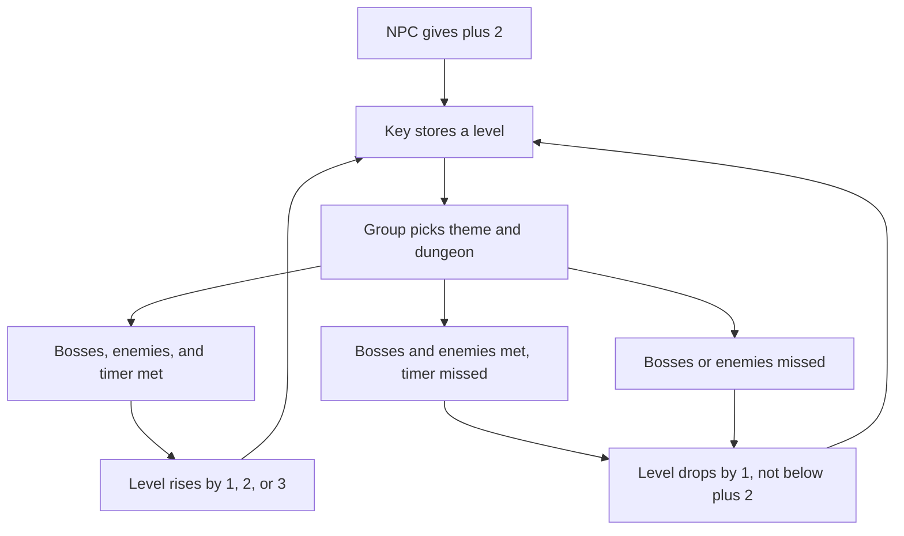
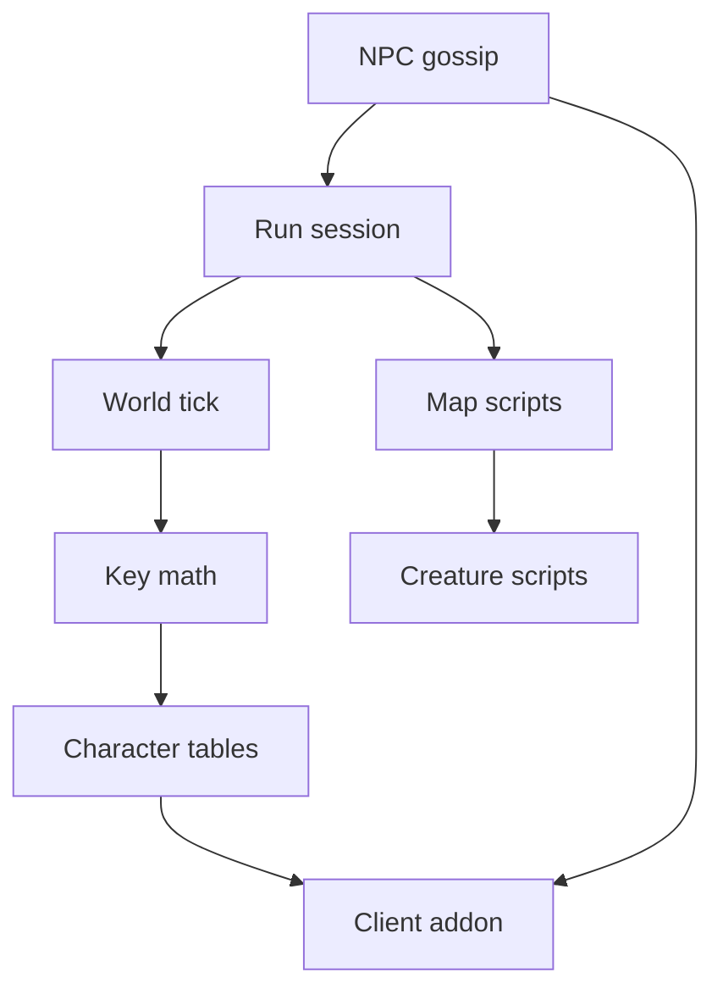
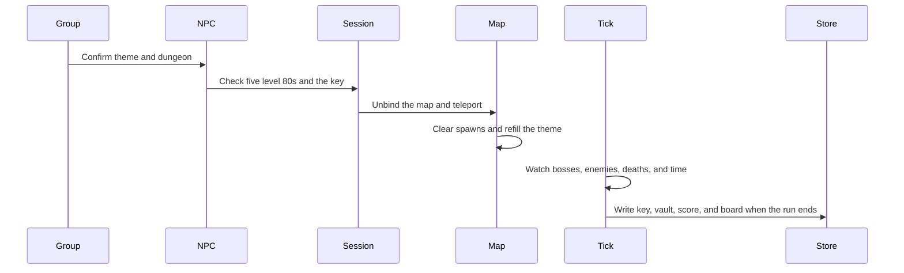
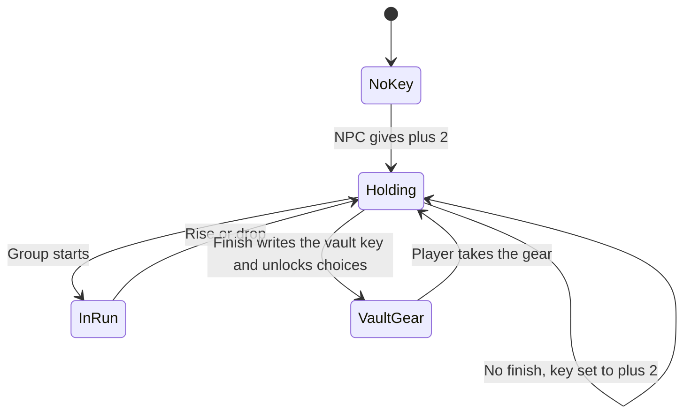

# Mythic Plus - Plan

## Goal Capsule

- **Objective:** Any five level 80 players can run a Mythic+ week: take a key, clear a dungeon they chose, and receive gear, a vault, and a public score.
- **Means:** Clone the dungeon builder into this module and tailor it to the key loop (KTD1).
- **Product authority:** This plan owns the whole loop. The installed Dungeon Master is not edited and is not required at runtime.
- **Execution:** The implementer builds this module and proves it on the test server. The operator installs it with Yu'lon, applies its SQL, and copies the client addon to members.
- **Stop conditions:** Stop if a change edits the installed Dungeon Master. Stop if a run can start with fewer than five players or with anyone under level 80. Stop if equipable enemy loot uses Need or Greed. Stop if a wipe ends the run by itself.
- **Open blockers:** None. Tuning numbers are the Assumptions table.

---

## Product Contract

Product Contract preservation: changed: R10, R25, the catalog Key Decision, and the own-module Key Decision — the builder's source list is 45 maps, and this module carries that builder so the installed Dungeon Master can be uninstalled. The endless chain stays outside the product.

### Summary

Any five level 80 players get the full Mythic+ loop in this module. They pick a theme and a dungeon, push a key that only stores a level, and the week pays gear, a vault, a score, and a fastest-clear board. This module is the dungeon builder that remains after Dungeon Master is uninstalled. A later season can change the dungeons and the modifiers. The loop stays.

### Problem Frame

Players have asked for retail Mythic+ on this Wrath server. The gap they named is a Mythic+ score. Dungeon Master already builds themed runs inside emptied instances, and it already keeps fastest-clear and endless-run boards. It does not offer a key that rises and falls, a weekly vault, or a Mythic+ score. The operator will uninstall that module, so the themed instances have to live here. The 3.3.5 client has no Mythic+ frames, and the core stops dungeon difficulty at Normal and Heroic.

### Key Decisions

- **The first build is the whole loop.** (session-settled: user-directed — chosen over a smaller first season: the user wants the entire system.) Governs R5, R16, R18, R20, R21.
- **This mode is its own module and replaces the installed builder.** (session-settled: user-directed — chosen over running on the installed Dungeon Master: the operator uninstalls that module, and this one carries the builder.) Governs R25.
- **The key stores a level, and the group picks the place.** (session-settled: user-directed — chosen over a dungeon-specific key and a weekly rotation: the group chooses the theme and dungeon every run.) Governs R4, R9, R11.
- **The first catalog is the builder's full list.** (session-settled: user-directed — chosen over a nine-dungeon list and over three themes: all 45 dungeons in the source list and all 9 themes are available.) Governs R10.
- **Five modifiers stack as the key rises.** (session-settled: user-directed — chosen over Fortified and Tyrannical only, and over one modifier at a time: a higher key adds the next modifier.) Governs R13.
- **A death adds time and combat end revives the group.** (session-settled: user-directed — chosen over a graveyard run and over a wipe ending the run: the death costs time, then the group is back at the entrance.) Governs R16, R17.
- **Score and fastest clear are both public.** (session-settled: user-directed — chosen over a score with no fastest-clear board: players can compare both.) Governs R21, R22.
- **End-of-run gear is personal.** (session-settled: user-directed — chosen over Need or Greed on equipable drops: gold and materials can still drop.) Governs R18, R19.
- **Any five level 80s can play.** (session-settled: user-directed — chosen over limiting the mode to groups that already use Dungeon Master: prior use is not required.) Governs R1, R2.
- **Seasons preserve the loop.** (session-settled: user-directed — chosen over letting a season change the loop: dungeons and modifiers may change, and the loop stays.) Governs R23.
- **A finish counts on time or late.** (session-settled: user-directed — chosen over requiring the timer for the week to count: the timer is what raises the key.) Governs R14, R15.
- **Bosses and the required enemies both count.** (session-settled: user-directed — chosen over bosses alone: skipping too many enemies leaves the run unfinished.) Governs R14.
- **Time left raises the key by 1, 2, or 3.** (session-settled: user-directed — chosen over a flat rise of 1: a faster clear raises the key further.) Governs R5.
- **The floor is +2.** (session-settled: user-directed — chosen over a +1 floor and over dropping under the base key: the NPC's key and the bottom of a downgrade are both +2.) Governs R3, R6.
- **One player's key is the run.** (session-settled: user-directed — chosen over changing every member's key: the other four still receive gear, vault progress, and score.) Governs R24.
- **The vault grows with finishes and pays gear.** (session-settled: user-directed — chosen over one finish unlocking every choice, and over a key with no gear: more finishes unlock more choices, up to three.) Governs R20.
- **The same dungeon can be repeated.** (session-settled: user-directed — chosen over removing a cleared dungeon for the rest of the week: only the key level changes between repeats.) Governs R11.

### Actors

- A1. A level 80 player who joins a keyed run.
- A2. The key holder, one of the five, whose key level changes.
- A3. This mode's NPC, who gives base keys and starts runs.
- A4. The operator who starts a new season.

### Requirements

**Party**

- R1. A keyed run starts only when the group is five players and every player is level 80.
- R2. Any level 80 player may take part, including a player who has never used Dungeon Master.

**Key**

- R3. A3 gives A1 a key at level +2 the first time that player needs one.
- R4. The key stores a level and does not store a dungeon or a theme.
- R5. When A2's group beats the timer with every boss dead and the required enemies dead, A2's key rises by 1, 2, or 3 according to the time left.
- R6. When the group misses the timer, the required enemies, or a boss, A2's key drops by 1 and does not go below +2.
- R7. When A2 timed at least one clear in the week, the vault returns a key at the highest level a timed clear reached, and a later downgrade does not reduce it.
- R8. When A2 finished at least once and never beat a timer, the vault returns a key at the level A2 holds at reset, and that level is not below +2.
- R9. When A2 finishes no dungeon in the week, A3 gives A2 a +2 key the following week.

**Run**

- R10. The group starts at A3, chooses a theme and a dungeon from the offered list, and is sent into an emptied instance that this mode refills for that choice. The first season offers the 45 dungeons and 9 themes in the builder's source list.
- R11. The same theme and dungeon may be chosen again immediately, with no cooldown and no weekly rotation.
- R12. A higher key level makes that dungeon harder than the level below it for a level 80 group.
- R13. Modifiers turn on in this fixed order as the key rises: Fortified, Tyrannical, Raging, Bolstering, Savage. Fortified is on at +2, and all five are on together once the ladder is complete.
- R14. The run is finished only when every boss is dead and the group has killed the required share of enemies, and every enemy this mode spawned counts toward that share.
- R15. A finish on time or late counts as a finish for the week, and only a finish inside the timer raises the key per R5.

**Result**

- R16. Each player death adds time, and enough deaths can change the result in R5 or R6.
- R17. When combat ends, dead players revive at the entrance.

**Rewards and record**

- R18. Each of the five players can receive their own gear at the end of a finished dungeon, and a higher key pays better gear than a lower key and better gear than a heroic dungeon.
- R19. Enemies do not drop equipable loot for Need or Greed, and they may drop gold and crafting materials.
- R20. When the week counts as finished, the vault offers gear scaled to the key in R7 or R8, and it includes that key. The first finish unlocks one gear choice, further finishes unlock more, and three is the cap.
- R21. Each player has one public score built from their best timed key level in each dungeon, and a worse later run does not lower a dungeon's best.
- R22. A separate public board ranks the fastest clear of each dungeon.
- R23. A season reset clears the score in R21 and may replace the dungeon and theme list in R10 or the modifiers in R13. The rest of the loop stays.
- R24. The run uses A2's key, only that key changes level, and every player in the group receives the gear, vault progress, and score credit for that clear.

**Module**

- R25. This module contains the dungeon builder and the Mythic+ loop, runs with the installed Dungeon Master uninstalled, and does not modify that module's files.
- R26. Players can see the key level, the active modifiers, the timer, the vault, and both boards. Anything the stock 3.3.5 client cannot show is carried by a client mod distributed to members.
- R27. The mode installs with Yu'lon as its own module.



### Key Flows

- F1. First key
  - **Trigger:** A1 has no key from this mode.
  - **Actors:** A1, A3
  - **Steps:** A1 speaks to A3. A3 gives a +2 key per R3.
  - **Outcome:** A1 holds a level key and has not yet chosen a dungeon.
  - **Covered by:** R3, R4
- F2. Keyed run
  - **Trigger:** Five level 80 players are together and A2 holds a key.
  - **Actors:** A1, A2, A3
  - **Steps:** The group speaks to A3, picks a theme and a dungeon, and enters the refilled instance. The key level sets the difficulty and the modifiers. Deaths add time. Combat end revives the dead at the entrance. The run ends when the group finishes per R14 or leaves the bosses or required enemies unkilled.
  - **Outcome:** A timed finish raises A2's key per R5. Any miss lowers it per R6. The group may start again at once per R11.
  - **Covered by:** R1, R5, R6, R10, R11, R12, R13, R14, R16, R17, R24
- F3. Weekly reset
  - **Trigger:** The week ends.
  - **Actors:** A2, A3
  - **Steps:** If A2 timed a clear, the vault holds the best timed level per R7. If A2 only finished late, the vault holds the level A2 has at reset per R8. If A2 finished nothing, A3 will give a +2 key per R9. Gear choices follow how many finishes the week contained, up to three.
  - **Outcome:** A2 receives the vault key and any unlocked gear choices, or a fresh +2 key from A3.
  - **Covered by:** R7, R8, R9, R15, R20
- F4. New season
  - **Trigger:** A4 starts a season.
  - **Actors:** A4, A1
  - **Steps:** The score in R21 is cleared. A4 may replace dungeons or modifiers.
  - **Outcome:** Players key, finish, and earn gear by the same loop.
  - **Covered by:** R23

### Acceptance Examples

- AE1. Timed clear
  - **Covers R5, R14, R15.**
  - **Given:** A2 holds +4 and the group kills every boss and the required enemies inside the timer.
  - **When:** The run ends.
  - **Then:** A2's key becomes +5, +6, or +7 according to the time left, and the week counts as finished.
- AE2. Late clear
  - **Covers R6, R8, R15.**
  - **Given:** A2 holds +4, the group kills every boss and the required enemies, and the timer has expired.
  - **When:** The run ends and the week ends with no timed clear.
  - **Then:** A2's key becomes +3, the week still counts as finished, and the vault returns +3.
- AE3. Unfinished run
  - **Covers R6, R9, R14.**
  - **Given:** A2 holds +4 and the group leaves a boss alive or skips too many enemies.
  - **When:** The run ends and the week ends with no finish.
  - **Then:** A2's key becomes +3, the week does not count as finished, and A3 gives a +2 key at the next reset.
- AE4. Floor
  - **Covers R6.**
  - **Given:** A2 holds +2 and the group misses the timer, a boss, or the required enemies.
  - **When:** The run ends.
  - **Then:** A2's key stays +2.
- AE5. Best of the week
  - **Covers R7.**
  - **Given:** A2 times a clear that reaches +8, then a later run drops the held key to +6.
  - **When:** The week ends.
  - **Then:** The vault key is +8.
- AE6. Repeat
  - **Covers R11.**
  - **Given:** The group just finished a chosen theme and dungeon.
  - **When:** They speak to A3 again in the same week.
  - **Then:** That same theme and dungeon can be chosen again, and no cooldown blocks them.
- AE7. Death
  - **Covers R16, R17.**
  - **Given:** A player dies during a run.
  - **When:** Combat ends.
  - **Then:** Time has been added for that death, and the dead player is at the entrance alive.
- AE8. Party gate
  - **Covers R1, R2.**
  - **Given:** Four level 80 players, or five players with one below level 80, speak to A3.
  - **When:** They try to start a run.
  - **Then:** The run does not start.
- AE9. Vault choices
  - **Covers R20.**
  - **Given:** The group finishes one dungeon, then finishes more dungeons that same week.
  - **When:** A2 opens the vault.
  - **Then:** The first finish unlocked one gear choice, a later finish unlocked a second, another unlocked a third, and a further finish adds no more.
- AE10. Score
  - **Covers R21, R22, R24.**
  - **Given:** The group times a dungeon on A2's key, and one member later times that same dungeon more slowly.
  - **When:** Another player looks up the board.
  - **Then:** Every member of the first clear has that dungeon's best updated, the slower clear does not replace it, and the fastest-clear board still shows the faster time.
- AE11. Season
  - **Covers R23.**
  - **Given:** A4 starts a season and changes the modifier list.
  - **When:** A group runs the next day.
  - **Then:** Scores from the old season are gone, the new modifiers apply, and a key still rises, falls, and pays a vault by the same rules.

### Scope Boundaries

**Deferred for later**

- Adding themes or dungeons beyond the current 45 and 9.
- Choosing a later season's dungeon list or modifier list. The reload path that applies a replacement is in this plan.

**Outside this product's identity**

- Editing the installed Dungeon Master, or requiring that module to stay enabled.
- The endless chain, solo or fewer than five players, and difficulty tiers named Novice through Grandmaster.
- A key that names a dungeon, a weekly dungeon rotation, and a weekly modifier set that is separate from the key level.
- Need or Greed rolls on equipable enemy drops.
- A cooldown between runs, and a wipe that ends the run by itself.

**Deferred to Follow-Up Work**

- Extra enemy packs on higher keys. R12 is met by the health and damage multiplier plus the modifier ladder.
- A bag item whose tooltip shows the live key level.
- Per-dungeon timer overrides after the default in the Assumptions table.
- A reward catalog larger than the starter rows U6 loads.

<!-- ce-section: work-relationships -->
### How This Work Fits Together

This plan covers the whole Mythic+ loop. The earlier split between a keyed run, modifiers, rewards, and score is one understanding of the work, not a roadmap, and this plan keeps those pieces together.

- The operator uninstalls Dungeon Master and runs this module in its place.
- This work does not edit the installed copy. That copy keeps its current behavior until the uninstall.
- A future season may change the dungeon list or the modifiers. That season is not a second product, and the loop in this plan still governs it.

### Dependencies / Assumptions

- The server is Wrath 3.3.5, and players can already reach level 80.
- The cloned builder can empty a real five-player instance and refill it with a chosen theme. That is how the 45 dungeons and 9 themes exist.
- The stock client cannot show a Mythic+ key, timer, modifier list, vault, or score. R26 covers the client mod that fills those gaps.
- Numeric defaults live in the Planning Contract Assumptions table. Those choices keep the order and the floor already set.
- R18 already requires a higher key to pay better gear than a lower key and better gear than a heroic. The gear steps are in that same table.

### Sources / Research

Clone-source paths below are relative to the test server root. Paths in the Planning Contract and Implementation Units are relative to this module.

- The test server's `modules/mod-dungeon-master/README.md` says 37 dungeons and 9 themes. `modules/mod-dungeon-master/src/DMConfig.cpp` holds `kDungeons`: 18 Classic, 12 TBC, and 15 WotLK, which is 45 maps. Scarlet Monastery is one row, map 189. The first season uses that array.
- The same README documents parties from solo through five, fastest-clear and endless-run boards, and no Mythic+ score.
- `modules/mod-dungeon-master/src/RoguelikeTypes.h` names Fortified, Tyrannical, Raging, Bolstering, and Savage. `modules/mod-dungeon-master/src/RoguelikeMgr.cpp` picks a shuffled subset of one to three. This mode stacks them by key level instead.
- `modules/mod-dungeon-master/src/DungeonMasterMgr.cpp` revives dead players at the entrance when combat ends, fails the run on a full wipe, and fills creature loot for Need or Greed. A separate mail and direct-give path already exists in that file for per-player rewards.
- That manager never unbinds an instance. The core binds a player on dungeon enter, so a second run of the same map can land in the saved instance unless this mode clears the bind first.
- The Wrath core's dungeon difficulty is Normal and Heroic. Uldaman's keystone object is not a Mythic+ key.
- `modules/mod-dungeon-master/CMakeLists.txt` registers `tests/DMBossSpawnQueryTest.cpp` with gtest through `ACORE_MODULE_TEST_SOURCES`. `modules/mod-dungeon-master/include.sh` is the empty Yu'lon marker. The loader symbol for that folder is `Addmod_dungeon_masterScripts`.
- `modules/mod-dungeon-master/data/sql/db-world/base/dm_setup.sql` creates NPC entry 500000. This mode uses a new entry.
- `../mod-bot-recruiter/PLAN.md` names the Yu'lon folders. That module is missing CMake, `include.sh`, and conf, so this module follows the installed Dungeon Master layout instead.

---

## Planning Contract

### Key Technical Decisions

- KTD1. **Carry the whole builder in this module.** (session-settled: user-directed — chosen over a key-only layer beside the installed module: the operator uninstalls Dungeon Master, so this module ships that builder with the Mythic+ changes.) The port keeps theme selection, the 45-map catalog, instance clear and refill, door and boss handling, the creature stat write U5 drives, entrance revive, and the fastest-clear record. The port omits the endless chain, the cooldown, wipe-fail, Need or Greed on equipable drops, the Novice–Grandmaster tier table, and the solo or per-player multiplier. Governs the mechanism for R10, R17, R25, R27.
- KTD2. **Season data lives in conf and SQL.** The dungeon list, themes, modifier bands, and reward rows are data the server reloads. A season can replace the dungeon list, the themes, and the bands for the five implemented modifiers under R23. The first load matches the 45-map source array, the nine theme rows, and R13. A sixth mechanic is follow-up work, because the reload cannot invent behavior the code does not already apply.
- KTD3. **A run starts in a fresh instance.** Before teleport, this mode unbinds the chosen map for each member on both normal and heroic. Teleport uses the core option that skips the enter check, so attunement items, dungeon quests, and the hourly instance cap do not refuse the group. A group-wide instance reset is the wrong tool: it returns early while the leader is inside a heroic. The core binds on enter, and the clone source never clears that bind. A Mythic+ run of a map also clears that player's saved lockout for the map.
- KTD4. **The key is a character row.** `mp_key` stores the level. Gossip text shows it. There is no bag item. A static item cannot show a level that changes during the week.
- KTD5. **Personal rewards use mail or direct give.** End-of-dungeon gear and vault gear go through the clone source's per-player reward path. Creature loot generation drops equipable items from the table it would have filled. Gold and crafting materials stay. This is the mechanism for R18 and R19.
- KTD6. **The client addon displays what the stock frames cannot.** The server sends addon messages, and gossip shows the same facts. Three levels stay labeled: the run key, which is A2's key and is what sets difficulty for all five; the viewer's own held key; and the viewer's vault key. The NPC lists that viewer's gear choices and both boards, and taking a choice grants the item. The in-run frame shows the active modifiers and the remaining time, stays up after the timer expires, and updates when a death adds time. A client without the addon can still finish from gossip. The addon is display only. The server decides the result.
- KTD7. **Tuning defaults are the Assumptions table.** Conf holds them. The first season matches R13, including Fortified at +2. A later season's data may move those five bands, including which modifier is on at +2. The +2 floor, a rise of 1, 2, or 3, and the three-choice vault cap stay on their R-IDs.
- KTD8. **Names do not collide with Dungeon Master.** The loader symbol is `Addmod_mythicplusScripts`. The command is `.mp`. Tables use the `mp_` prefix. Conf keys use the `MythicPlus.` prefix. The NPC is a new creature entry with script name `npc_mythic_plus`, not entry 500000 and not `npc_dungeon_master`.
- KTD9. **Difficulty uses the map's existing heroic mode.** When the map has a heroic, the party enters heroic. Otherwise the party enters normal. Key level then multiplies health and damage above that baseline, and the modifier ladder applies on top. The core has no Mythic difficulty to select. This is the mechanism for R12.

### Assumptions

These are the KTD7 defaults. Tests and conf use these values unless an operator changes conf.

| Knob | Default |
| --- | --- |
| Death penalty | 5 seconds added to elapsed |
| Timer | 1800 seconds |
| Rise of 3 | At least 40 percent of the timer still remaining |
| Rise of 2 | At least 20 percent remaining, and less than 40 |
| Rise of 1 | Any time remaining below 20 percent |
| Tyrannical on | Key level 4 and above |
| Raging on | Key level 7 and above |
| Bolstering on | Key level 10 and above |
| Savage on | Key level 12 and above |
| Enemy share | 80 percent of enemies this mode spawned |
| Gear | Item level 245 at key 2, plus 3 item levels for each key level above 2 |
| Health and damage | 1.10 + 0.10 times (key level minus 2), on the KTD9 baseline |
| Score | Sum, across dungeons, of best timed key level times 10 |
| Weekly reset | Wednesday at 08:00 server time. A run still inside the instance keeps the week it started. The reset applies once when that run resolves |
| Vault replacement | An unclaimed vault is replaced at the next reset |
| Season and keys | A season clears score bests and leaves held key levels in place |

A timed clear's "level reached" is the key level after the rise in R5. That is the number R7 stores. End-of-dungeon gear uses the key level the run started at. A late finish stores no timed best. Zero spawned enemies does not meet the share. That run is a miss under R6: the key drops by 1, not below +2, and the week does not gain a finish.

The player who confirms the start is A2. Each of the other four receives gear, a vault choice, and score credit. Their own `mp_key` level does not change. Their vault key becomes the group's result when that result is higher than the vault key they already stored for the week.

### High-Level Technical Design

The NPC creates a session. Map scripts build the instance. A one-second world tick owns the timer, deaths, and the end of the run. Character tables hold the key, the vault, the score, and the fastest clear. The addon reads server messages and does not decide the result.



A start refuses a bad party, then clears the bind, then fills the instance. The world tick watches the run. When the run ends, that tick resolves it and writes the store.



The week keeps the key holder in Holding while they run. A reset that arrives during InRun waits. When the run returns to Holding, the reset writes once, using the week the run started. A week with no finish stays in Holding and sets the key to +2. A week with a finish writes the vault key and moves to VaultGear, where the choices wait. Taking the gear returns the holder to Holding. A miss during the week drops the level and stays in Holding.



Directional sketch of the resolve step, not the implementation:

```text
elapsed = elapsed + deaths * deathPenalty
if spawned is 0:
  drop by 1, floor 2
  do not count a finish
else if bosses dead and killed >= share of spawned:
  if elapsed < limit:
    rise by the remaining-time band
    store the level reached as a timed best
  else:
    drop by 1, floor 2
    count a late finish
else:
  drop by 1, floor 2
  do not count a finish
```

### Sequencing

1. U1 builds the module shell Yu'lon can install.
2. U2 ports the builder and stops before the key rules.
3. U3 starts a run. U4 and U5 both depend on that session. U5 can land beside U4.
4. U6 pays the week. U7 records score and speaks to the addon, and it needs the modifier ladder from U5. U8 adds the operator command and the cutover notes.

### System-Wide Impact

- Players speak to the new NPC. Every member who receives the copied addon gets the in-run frame, the vault list, and both boards. The operator copies `client/MythicPlus` to members.
- Game masters use `.mp`. The old `.dm` command belongs to the module being uninstalled.
- A keyed run clears the party's saved lockout for that map. Players lose a heroic lockout they still wanted on that map.
- If both modules are enabled during cutover, they use different NPC entries, tables, conf prefixes, and commands. This work still must not edit the installed module.
- Creature scripts re-apply this mode's health after other modules adjust creatures, so a player-count scaler cannot silently undo the key multiplier.
- This mode does not read SoloCraft buffs and does not use a world-state timer. Zul'Aman's timer is a different system.

### Risks

- The second run is the fragile one. If the bind clear fails, the party enters a saved instance and the refill does not run. U3's live check is the proof.
- Porting the builder can drag the endless chain, the cooldown, group loot, and the tier or party-size multipliers in with it. U2 deletes those paths. The Definition of Done refuses a tree that still starts them.
- Reward rows need real Wrath item ids at the Assumption item levels. U6 ships a starter set. A thin starter set still has to pay better gear at a higher key.
- Yu'lon copies the server module. It does not copy `client/MythicPlus` into the game client. The README has to say that, or members never see the timer frame.
- The weekly boundary is server-local Wednesday 08:00 until an operator changes it. Two realms that wanted different reset days need different conf.

### Alternatives Considered

- Leave Dungeon Master installed and add a key layer beside it. The operator is uninstalling that module, so the builder has to move.
- Build a new instance filler and ignore the clone source. The clone source already empties a map and refills it by theme. A second filler would re-solve that.
- Keep the 45 maps in a compiled array only. R23 lets a season replace the list. Conf and SQL reload. A compiled array does not.

---

## Output Structure

Paths are relative to this module. The implementer may rename a file if the loader still exposes `Addmod_mythicplusScripts` and the tests still cover the same behavior.

```text
include.sh
CMakeLists.txt
README.md
conf/mod_mythicplus.conf.dist
src/MythicPlus_loader.cpp
src/MPConfig.h
src/MPConfig.cpp
src/MPTypes.h
src/MPKeyMath.h
src/MPKeyMath.cpp
src/MPModifiers.h
src/MPModifiers.cpp
src/MPRewards.h
src/MPRewards.cpp
src/MPScore.h
src/MPScore.cpp
src/MythicPlusMgr.h
src/MythicPlusMgr.cpp
src/scripts/npc_mythic_plus.cpp
src/scripts/mp_player_script.cpp
src/scripts/mp_world_script.cpp
src/scripts/mp_allmap_script.cpp
src/scripts/mp_allcreature_script.cpp
src/scripts/mp_unit_script.cpp
src/scripts/mp_command_script.cpp
data/sql/db-world/base/mp_setup.sql
data/sql/db-world/base/mp_rewards.sql
data/sql/db-characters/base/mp_characters.sql
client/MythicPlus/MythicPlus.toc
client/MythicPlus/MythicPlus.lua
tests/MPCatalogTest.cpp
tests/MPPartyAndKeyTest.cpp
tests/MPKeyMathTest.cpp
tests/MPModifierLadderTest.cpp
tests/MPVaultTest.cpp
tests/MPScoreTest.cpp
tests/MPCommandTest.cpp
```

Character tables, named here so later units share them: `mp_key`, `mp_vault`, `mp_dungeon_best`, `mp_leaderboard`. Column details may change. The rules in the Product Contract may not.

---

## Implementation Units

### U1. Module shell Yu'lon can install

- **Goal:** The test server can load this module, read its conf, and spawn its NPC.
- **Requirements:** R25, R27
- **Dependencies:** None
- **Files:** `include.sh`, `CMakeLists.txt`, `README.md`, `conf/mod_mythicplus.conf.dist`, `src/MythicPlus_loader.cpp`, `data/sql/db-world/base/mp_setup.sql`
- **Approach:**
  1. Add the empty Yu'lon marker, CMake script registration, and the loader symbol from KTD8.
  2. Add conf for every knob in the Assumptions table, read through the server config manager.
  3. Add world SQL for a new NPC and the script name from KTD8. Copy the shape of the clone source's `dm_setup.sql`, not its creature entry.
  4. Point the README at install, SQL, the addon copy, and the Dungeon Master uninstall. U8 fills the cutover steps.
- **Patterns to follow:** `modules/mod-dungeon-master/CMakeLists.txt`, `modules/mod-dungeon-master/include.sh`, `modules/mod-dungeon-master/src/DungeonMaster_loader.cpp`
- **Test scenarios:**
  - Test expectation: none — this unit is packaging and SQL. U2 and later units cover behavior.
- **Verification:** The module configures under the test server, the loader symbol matches the folder name, and the NPC SQL uses a creature entry other than 500000.

### U2. Port the dungeon builder

- **Goal:** A chosen theme and map produce an emptied instance refilled with themed creatures, using the 45-map list and nine themes.
- **Requirements:** R10, R12, R25
- **Dependencies:** U1
- **Files:** `src/MPConfig.h`, `src/MPConfig.cpp`, `src/MPTypes.h`, `src/MythicPlusMgr.h`, `src/MythicPlusMgr.cpp`, `src/scripts/mp_allmap_script.cpp`, `src/scripts/mp_allcreature_script.cpp`, `src/scripts/mp_unit_script.cpp`, `tests/MPCatalogTest.cpp`
- **Approach:**
  1. Port clear, refill, door opening, boss neutralization, and entrance positions from the clone source.
  2. Load maps and themes through KTD2. The first dataset matches `kDungeons` and the nine theme rows.
  3. Do not port the endless-chain manager, the cooldown, group loot, the Novice–Grandmaster tier table, or the solo and per-player multipliers.
  4. Re-apply this mode's creature health after other scripts adjust it.
- **Execution note:** Compare clear, door, and boss behavior with the clone source before changing it. Keep the boss-spawn query's current immunity columns, as `tests/DMBossSpawnQueryTest.cpp` already locks them.
- **Patterns to follow:** `modules/mod-dungeon-master/src/DMConfig.cpp`, `modules/mod-dungeon-master/src/DungeonMasterMgr.cpp`, `modules/mod-dungeon-master/src/scripts/dm_allmap_script.cpp`, `modules/mod-dungeon-master/src/scripts/dm_allcreature_script.cpp`
- **Test scenarios:**
  - Happy path: a full load returns 45 maps and 9 themes, including map 189 once and map 36 once.
  - Edge: removing one map in data leaves 44, and map 36 can be the one removed.
  - Error: a theme row with an empty creature type fails that row and the other eight still load.
  - Integration: the boss spawn query for map 229 selects `ct.entry` and `creature_immunities`, and it does not select `mechanic_immune_mask`.
- **Verification:** `tests/MPCatalogTest.cpp` passes inside the test server's module test build. The loader does not reference the endless chain, a tier table, or a per-player multiplier.

### U3. Party gate, key, and run start

- **Goal:** Five level 80 players can start a chosen dungeon on one player's level key, and they can start that same dungeon again.
- **Requirements:** R1, R2, R3, R4, R10, R11, F1, F2
- **Dependencies:** U1, U2
- **Files:** `src/scripts/npc_mythic_plus.cpp`, `src/scripts/mp_player_script.cpp`, `src/MythicPlusMgr.cpp`, `data/sql/db-characters/base/mp_characters.sql`, `tests/MPPartyAndKeyTest.cpp`
- **Approach:**
  1. The confirming player is A2. Create an `mp_key` row at level 2 when that player has none (R3, KTD4).
  2. Refuse the start unless the group matches R1.
  3. Store the level only (R4).
  4. Unbind and teleport per KTD3, then let the builder from U2 fill the instance.
  5. Do not store a cooldown. Gossip offers theme and dungeon only. Do not copy the clone source's difficulty or scaling menus.
- **Execution note:** On the test server, bind the map once, start a second run, and confirm the party is in a new instance before treating R11 as done.
- **Patterns to follow:** `modules/mod-dungeon-master/src/scripts/npc_dungeon_master.cpp` for the shape of a gossip NPC. The menu starts at theme and dungeon. The party gate replaces the cooldown check.
- **Test scenarios:**
  - Covers AE8. Four level 80 players produce a refusal and no session.
  - Covers AE8. Five players, one at level 79, produce a refusal and no session.
  - Covers F1. A player with no `mp_key` row receives level 2 and a null map.
  - Covers AE6. After a stored session for map 36, a second confirm for map 36 requests a fresh instance and is not blocked by a cooldown.
  - Edge: a player who already holds level 2 does not receive a second starter key on a later visit in the same week.
  - Error: an unknown map id refuses the start and leaves the key level unchanged.
- **Verification:** `tests/MPPartyAndKeyTest.cpp` passes, and the live second run in the execution note enters an empty instance the builder then refills.

### U4. Timer, deaths, finish, and key changes

- **Goal:** The running instance raises or lowers A2's key from bosses, the enemy share, the timer, and deaths.
- **Requirements:** R5, R6, R7, R8, R14, R15, R16, R17, F2
- **Dependencies:** U3
- **Files:** `src/MPKeyMath.h`, `src/MPKeyMath.cpp`, `src/scripts/mp_world_script.cpp`, `src/scripts/mp_player_script.cpp`, `src/MythicPlusMgr.cpp`, `tests/MPKeyMathTest.cpp`
- **Approach:**
  1. Put the resolve rules in `MPKeyMath` so tests do not need a running map.
  2. The world tick adds elapsed time. A death adds the Assumption penalty (R16).
  3. When combat ends, revive dead players at the entrance (R17). Do not fail the run because everyone died.
  4. Count a finish from R14 and R15. Apply R5 or R6. Store the week fields R7 and R8 need. If the weekly boundary passed during the run, apply that week's reset once after this resolve, using the week the run started.
- **Patterns to follow:** The entrance-revive tick in `modules/mod-dungeon-master/src/DungeonMasterMgr.cpp`. Do not follow its wipe-fail branch.
- **Test scenarios:**
  - Covers AE1. Key 4, limit 1800, elapsed 1000, bosses dead, 80 percent killed: remaining time is 800, which is at least 40 percent, so the key becomes 7 and the week is finished.
  - Covers AE1. The same inputs with elapsed 1400 leave 400 seconds, which is at least 20 percent and below 40, so the key becomes 6.
  - Covers AE1. Elapsed 1700 leaves 100 seconds, so the key becomes 5.
  - Covers AE2. Key 4, elapsed 1800 or more, bosses dead, share met: the key becomes 3, the week is finished, and no timed best is stored.
  - Covers AE3. Key 4 with a boss still alive: the key becomes 3 and the finish count stays 0.
  - Covers AE4. Key 2 with a miss stays 2.
  - Covers AE5. A stored timed result of 8 remains the week's vault key after a later held level of 6.
  - Covers AE7. Elapsed 1798 plus one death of 5 seconds becomes 1803, so a run that then meets bosses and the share downgrades instead of rising.
  - Edge: zero spawned enemies is a miss. Key 4 becomes 3, the finish count stays 0, and no timed best is stored. A living boss is also a miss.
  - Edge: a run that started before the weekly boundary and resolves after it applies that week's reset once. A second pass does not apply it again.
  - Error: resolving a session that never started leaves the stored key unchanged.
- **Verification:** `tests/MPKeyMathTest.cpp` passes, and a wipe on the test server revives the group at the entrance with the run still active.

### U5. Modifier ladder and key scaling

- **Goal:** Each higher key is harder, and the five modifiers turn on in order.
- **Requirements:** R12, R13
- **Dependencies:** U2, U3
- **Files:** `src/MPModifiers.h`, `src/MPModifiers.cpp`, `src/MythicPlusMgr.cpp`, `src/scripts/mp_allcreature_script.cpp`, `tests/MPModifierLadderTest.cpp`
- **Approach:**
  1. Select modifiers from the Assumption bands (R13, KTD7).
  2. Apply them in list order on creatures the builder spawned.
  3. Multiply health and damage by the Assumption curve on the KTD9 baseline.
- **Patterns to follow:** The modifier definitions in `modules/mod-dungeon-master/src/RoguelikeTypes.h`. Do not follow the shuffled subset in `RoguelikeMgr.cpp`.
- **Test scenarios:**
  - Happy path: key 2 enables only Fortified. Key 12 enables Fortified, Tyrannical, Raging, Bolstering, and Savage.
  - Edge: key 3 stays Fortified only. Key 4 adds Tyrannical. Key 11 has four modifiers. Key 1 is treated as key 2.
  - Error: a conf name this mode does not know is ignored. A season dataset that omits Fortified does not inject it. The first-season dataset still enables Fortified at key 2.
  - Integration: with Fortified and Tyrannical both on, a non-boss receives the Fortified health change and a boss receives the Tyrannical health change.
- **Verification:** `tests/MPModifierLadderTest.cpp` passes, and a key 3 group on the test server sees a harder dungeon than a key 2 group in the same map and theme.

### U6. Personal loot, vault, and weekly reset

- **Goal:** A finish pays each player, and the weekly reset returns the right key and the right number of gear choices.
- **Requirements:** R7, R8, R9, R15, R18, R19, R20, R24, F3
- **Dependencies:** U4
- **Files:** `src/MPRewards.h`, `src/MPRewards.cpp`, `data/sql/db-world/base/mp_rewards.sql`, `data/sql/db-characters/base/mp_characters.sql`, `tests/MPVaultTest.cpp`
- **Approach:**
  1. Remove equipable items from creature loot for this mode's creatures. Leave gold and materials (KTD5, R19).
  2. On a finish, give each of the five a personal item for the key level the run started at (R18). Vault gear uses the post-rise level R7 stores.
  3. Increment each member's finish count, capped at three choices (R20). The NPC lists those choices. Taking one grants it by mail or direct give.
  4. At reset, apply R7, R8, or R9 to A2. Apply the vault-key rule in Assumptions to the other four (R24). If the run was still inside the instance at the boundary, wait until U4 resolves it, then apply that week once.
  5. Seed `mp_rewards.sql` with real Wrath items at the Assumption item levels so a higher band is a higher item level than a lower band, and key 2 is above heroic item level 232.
- **Patterns to follow:** The mail and direct-give helpers in `modules/mod-dungeon-master/src/DungeonMasterMgr.cpp`. Do not follow `FillCreatureLoot` for equipable items.
- **Test scenarios:**
  - Covers AE9. Finish counts 1, 2, 3, and 4 unlock 1, 2, 3, and 3 choices.
  - Covers AE2. A late finish that leaves the held key at 3 stores vault key 3 when the week had no timed clear.
  - Covers AE5. Vault key 8 stays 8 after the held key drops to 6.
  - Covers AE3. Zero finishes at reset replaces held key 3 with key 2.
  - Happy path: a run that started at key 2 pays item level 245. A run that started at key 3 pays 248. Key 4 pays 251. Vault gear for a timed result of 5 pays 254.
  - Edge: a member who is not A2 gains a vault choice and keeps their previous `mp_key` level.
  - Error: an unfinished run adds no choice and grants no end-of-dungeon gear.
  - Integration: loot generation for a creature this mode spawned returns no equipable item and can still return a crafting material.
- **Verification:** `tests/MPVaultTest.cpp` passes, and a finished test-server run puts gear on all five players without a Need or Greed roll.

### U7. Score, fastest board, and client display

- **Goal:** Players can look up a score, a fastest clear, and the live state of a run.
- **Requirements:** R21, R22, R23, R26, F4
- **Dependencies:** U4, U5, U6
- **Files:** `src/MPScore.h`, `src/MPScore.cpp`, `client/MythicPlus/MythicPlus.toc`, `client/MythicPlus/MythicPlus.lua`, `data/sql/db-characters/base/mp_characters.sql`, `tests/MPScoreTest.cpp`
- **Approach:**
  1. On a timed finish, raise each member's best for that map when the level reached is higher (R21).
  2. Publish the Assumption score, and keep a separate fastest time per map (R22).
  3. A season clear deletes `mp_dungeon_best` for the old season and leaves `mp_key` levels in place (R23, Assumptions).
  4. Send addon messages per KTD6. The addon TOC targets interface 30300. Gossip shows the run key, the viewer's held key, the viewer's vault key, the gear choices, and both boards. The in-run frame stays up after the timer expires.
- **Patterns to follow:** The fastest-clear insert in the clone source's character SQL, extended with key level and theme. The addon only parses server text.
- **Test scenarios:**
  - Covers AE10. A timed result of 8, then a slower timed result of 6, leaves the best at 8 for every member of the first clear. The board keeps the faster time. The score uses 8.
  - Covers AE11. After a season clear, the best is empty and key level 7 is still 7. A later timed result of 4 becomes the new best.
  - Happy path: bests of 10 and 4 on two maps score 140.
  - Edge: a late finish does not change the best, and it records the fastest time when no faster row exists.
  - Error: a slower time does not replace a stored board row.
  - Integration: the outbound message for a key 4 run with 900 seconds left names run key 4, the modifiers enabled at key 4, and 900. A message after the limit names the timer expired and keeps the modifier names. A lookup with no rows returns an empty board.
- **Verification:** `tests/MPScoreTest.cpp` passes. On the test server the addon shows the run key, modifiers, and remaining time to all five, including after the timer expires. Gossip shows the viewer's held key, vault key, gear choices, score, and fastest clear. Those two key numbers match only for the key holder.

### U8. Operator command and cutover

- **Goal:** An operator can reload data, start a season, and inspect a key, and the README tells them how to replace Dungeon Master.
- **Requirements:** R23, R25, R26, R27, F4
- **Dependencies:** U1, U5, U7
- **Files:** `src/scripts/mp_command_script.cpp`, `conf/mod_mythicplus.conf.dist`, `README.md`, `tests/MPCommandTest.cpp`
- **Approach:**
  1. Register `.mp` for reload, season start, key inspect, and key set (KTD8).
  2. Season start reloads catalog and modifier data and clears score bests (R23). It does not change held key levels.
  3. Write the cutover in the README: uninstall Dungeon Master, install this module with Yu'lon, apply world and character SQL, and copy `client/MythicPlus` to members.
- **Patterns to follow:** `modules/mod-dungeon-master/src/scripts/dm_command_script.cpp`, with a new command name.
- **Test scenarios:**
  - Covers AE11. Season start clears a stored best of 8 and leaves key level 7 unchanged. A reload that sets Savage at key 6 reports Savage on at key 6 and off at key 5.
  - Error: a player who is not a game master is refused `.mp`.
  - Edge: key set refuses a level below 2 and leaves the stored level unchanged.
- **Verification:** `tests/MPCommandTest.cpp` passes, `.dm` is not registered by this module, and the README names the uninstall and the addon copy.

---

## Verification Contract

The module repo has no test runner of its own. Tests use gtest, the same style as `modules/mod-dungeon-master/tests/DMBossSpawnQueryTest.cpp`, and `CMakeLists.txt` appends them to `ACORE_MODULE_TEST_SOURCES`. Proof is a build of the test server after this module is installed beside the other modules.

| Check | What proves it | Covers |
| --- | --- | --- |
| Catalog, party, key math, modifiers, vault, score, command | The seven test files under `tests/` in the server's module test build | AE1–AE5, AE8–AE11, and the logic half of AE6 and AE7 |
| Second run | Five level 80s finish a dungeon, speak to the NPC, and enter a newly filled instance of the same map | AE6, R11, KTD3 |
| Death in combat | One death adds time, a wipe leaves the run active, and the dead player is alive at the entrance when combat ends | AE7, R16, R17 |
| Loot | A spawned creature drops no equipable item, and each of the five receives end gear with no Need or Greed roll | R18, R19 |
| Display | The addon shows the run key, modifiers, and remaining time, including after expiry. Gossip shows the held key, the vault key, the gear choices, the score, and the fastest clear | R26 |
| Installed module | The test server's `modules/mod-dungeon-master` tree has no edits from this work | R25 |
| Install shape | `include.sh` exists, conf is `conf/mod_mythicplus.conf.dist`, and SQL sits under `data/sql/db-world` and `data/sql/db-characters` | R27 |

---

## Definition of Done

- U1 through U8 each meet their own Verification line.
- The seven gtest files pass in the test server's module test build.
- The live checks in the Verification Contract have been run on the test server, or the implementer has recorded which live check could not be run and why.
- Conf defaults match the Assumptions table.
- The loader does not reference the endless chain, a cooldown gate, Need or Greed for equipable drops, a Novice–Grandmaster tier, or a solo or per-player multiplier.
- The test server's installed Dungeon Master sources are unchanged.
- The README tells the operator to uninstall Dungeon Master and to copy `client/MythicPlus` to members.
- Code left from an abandoned approach is removed before the work is called done.
